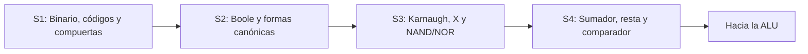

<div align="center">


# UNIVERSIDAD NACIONAL DE LOJA
**Carrera de Computación**

---

# CUADERNO DE APRENDIZAJE VIRTUAL

## Diseño de Circuitos
Unidad 1 · Lógica combinacional con diseño clásico
**Contenidos: Semanas 1, 2, 3 (sesiones 1 y 2 unificadas) y 4**

---

| | |
|---|---|
| **Asignatura** | Diseño de Circuitos |
| **Docente** | Ing. Luis Darío Sinche Cueva, Mg. |
| **Estudiante** | David Luna Lara |
| **Ciclo / paralelo** | 2.º ciclo A |
| **Período académico** | Septiembre 2026 – marzo 2027 |

**Loja – Ecuador · 2026**

</div>

---

## Índice

| Semana | Tema | Archivo |
|---|---|---|
| 1 | Sistemas numéricos, códigos y compuertas lógicas | [semana-01.md](semana-01.md) |
| 2 | Álgebra de Boole y formas canónicas | [semana-02.md](semana-02.md) |
| 3 | Mapas de Karnaugh, condiciones indiferentes y NAND/NOR (unificada) | [semana-03.md](semana-03.md) |
| 4 | Circuitos aritméticos: sumadores, resta, overflow y comparador | [semana-04.md](semana-04.md) |

## Mapa de la unidad



## Uso con Git

Cada semana se registra como un *commit* distinto. Para seguir construyendo el cuaderno:

```bash
git log --oneline                 # historial de semanas
git add semana-05.md
git commit -m "Semana 5: multiplexores"
git remote add origin <URL-del-repositorio>
git push -u origin main
```

Para verlo como sitio web, activar GitHub Pages en *Settings → Pages* sobre la rama `main`.

> Fuente de los contenidos: diapositivas del docente (Semanas 1 a 4). Este cuaderno es un resumen de estudio.
