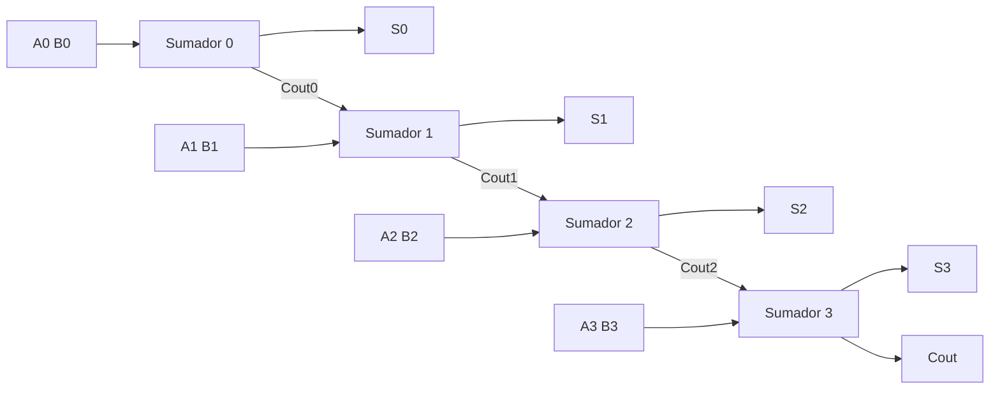

# Semana 4 · Circuitos aritméticos

**Objetivo:** diseñar con el procedimiento clásico un circuito que suma números binarios de 4 bits, usarlo también para restar y estimar cuánto tarda. Es el corazón de la ALU.

## 1. Sumar un bit
| Operación | Resultado | S (escribo) | C (me llevo) |
|---|---|---|---|
| 0 + 0 | 0 | 0 | 0 |
| 0 + 1 | 1 | 1 | 0 |
| 1 + 0 | 1 | 1 | 0 |
| 1 + 1 | 10₂ | 0 | 1 |

Como en decimal (`7 + 5 = 12`: escribo 2, llevo 1). Un acarreo puede provocar otro: se encadenan.

```
acarreo  1 1 0 0           acarreo  1 1 1 0
         0 1 1 0 ( 6)               0 1 1 1 (7)
       + 0 1 1 1 ( 7)             + 0 0 0 1 (1)
         ---------                  ---------
         1 1 0 1 (13)               1 0 0 0 (8)
```

## 2. Dos tipos de columna, dos circuitos
- **Columna 0:** suma 2 bits (A y B) → **semisumador**.
- **Columnas 1, 2, 3…:** suman 3 bits (A, B y el acarreo de entrada Cin) → **sumador completo**.

## 3. Semisumador
| A | B | C | S |
|---|---|---|---|
| 0 | 0 | 0 | 0 |
| 0 | 1 | 0 | 1 |
| 1 | 0 | 0 | 1 |
| 1 | 1 | 1 | 0 |

**`S = A ⊕ B`** (XOR) · **`C = A · B`** (AND). «Semi» porque no recibe acarreo: solo sirve para la columna 0.

## 4. Sumador completo: el truco de contar unos
| A | B | Cin | # de 1 | Binario | Cout | S |
|---|---|---|---|---|---|---|
| 0 | 0 | 0 | 0 | 00 | 0 | 0 |
| 0 | 0 | 1 | 1 | 01 | 0 | 1 |
| 0 | 1 | 0 | 1 | 01 | 0 | 1 |
| 0 | 1 | 1 | 2 | 10 | 1 | 0 |
| 1 | 0 | 0 | 1 | 01 | 0 | 1 |
| 1 | 0 | 1 | 2 | 10 | 1 | 0 |
| 1 | 1 | 0 | 2 | 10 | 1 | 0 |
| 1 | 1 | 1 | 3 | 11 | 1 | 1 |

- **S = 1** cuando hay un número **impar** de unos.
- **Cout = 1** cuando hay **al menos dos** unos (la mayoría).

**K-map de S:** unos alternados («tablero de ajedrez»), ningún 1 tiene vecino → no hay grupos → es XOR:
`S = A ⊕ B ⊕ Cin`

**K-map de Cout:** tres grupos de dos → `Cout = AB + A·Cin + B·Cin`

**No hay que memorizar las fórmulas:** tabla de verdad contando unos → K-map (si sale ajedrez es XOR) → expresión y su lectura en palabras.

## 5. Sumador de 4 bits y retardo «ripple»

Regla única: **Cout de un sumador → Cin del siguiente**. Cada etapa espera el acarreo de la anterior: el resultado se completa de derecha a izquierda, como una ola (*ripple carry*).

**Estimación del retardo** (cada compuerta ≈ 10 ns, el acarreo cruza ≈ 2 compuertas por etapa): `Retardo ≈ 2 · n · 10 ns`

| Bits | Compuertas | Tiempo |
|---|---|---|
| 4 | 8 | 80 ns |
| 16 | 32 | 320 ns |
| 32 | 64 | 640 ns |

## 6. Restar es sumar el negativo
`A − B = A + (−B)` y `−B` = invertir los bits de B y sumar 1.

```
B = 0011 (3) → inv = 1100 → +1 = 1101 (−3)
  0110 (6)
+ 1101 (−3)
-------
1 0011 → 3 ✓   (el 1 que sobra se descarta)
```

**XOR como inversor controlado:** `B ⊕ M`. Si `M = 0`, B pasa igual (**suma**); si `M = 1`, B se invierte (**resta**). Además M se conecta al **Cin del sumador 0**, que aporta el +1. Un solo circuito suma o resta según M.

## 7. Overflow
```
  0101 (+5)
+ 0100 (+4)
-------
  1001 → −7 ✗
```
Con 4 bits y signo el rango es −8 a +7. **Cout = 1 NO significa error.** Hay overflow si el acarreo que entra a la última etapa es distinto del que sale: **`V = C3 ⊕ C4`**.

## 8. Comparador de magnitud
- **¿A = B?** XNOR en cada bit (1 si son iguales) y AND de todas.
- **¿A > B?** Desde la izquierda: el primer bit en que difieren decide. Con 2 bits: A > B si A gana en el bit alto, o empatan ahí y A gana en el bajo. Integrado **7485**.

## 9. De aquí sale la ALU
Sumador/restador + comparador + AND/OR/XOR + multiplexor (semana 5) → resultado de la instrucción.

## 10. Demostración: `0101 + 0011`
| Etapa | A | B | Cin | # de 1 | S | Cout |
|---|---|---|---|---|---|---|
| 0 | 1 | 1 | 0 | 2 | 0 | 1 |
| 1 | 0 | 1 | 1 | 2 | 0 | 1 |
| 2 | 1 | 0 | 1 | 2 | 0 | 1 |
| 3 | 0 | 0 | 1 | 1 | 1 | 0 |

Resultado `1000 = 8`: correcto sin signo, **overflow** con signo (5 + 3 = 8 > 7).

## Resumen
`S` se escribe, `C` me llevo · semisumador: S = XOR, C = AND (solo columna 0) · completo: S = impar de unos, Cout = al menos dos · ripple: el acarreo avanza etapa por etapa · resta: M = 1 (XOR invierte B y Cin = 1) · overflow: `V = C3 ⊕ C4`, no Cout.

